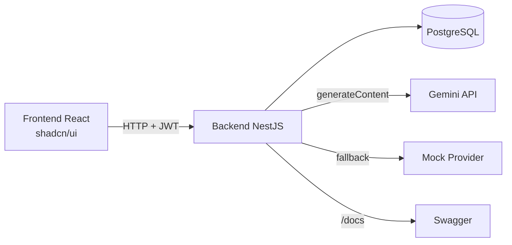
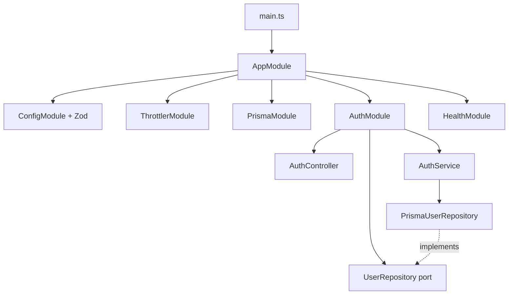
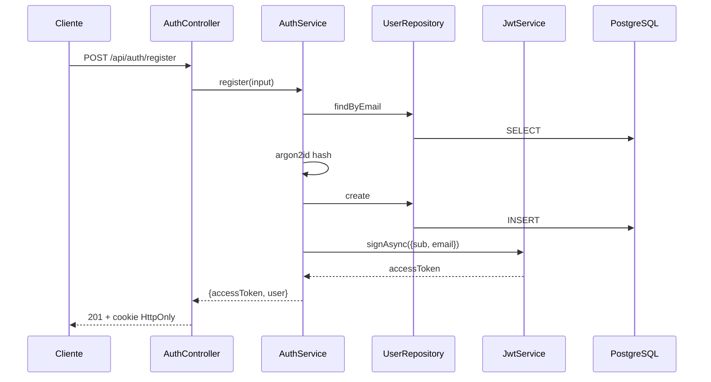
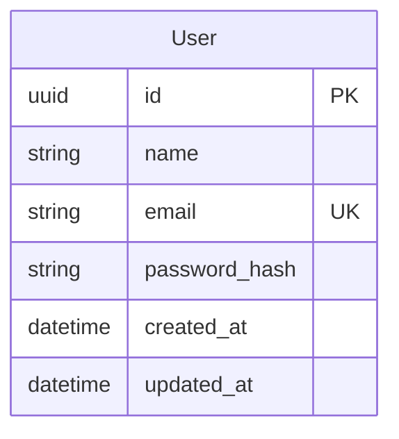

# Arquitetura

## Contexto

CareFlow é a aplicação de acompanhamento dos prazos legais da linha de cuidado do
câncer. O repositório documenta o módulo Dia 30, com autenticação, IA assistiva e uma
base de qualidade pronta.

## Visão geral

- O frontend entrega o painel da navegadora e a visão pública da paciente.
- O backend é um monólito modular.
- O PostgreSQL é o único serviço de infraestrutura local.
- O Gemini é opcional: sem chave ou em falha, o mock responde.

## Módulos do backend

### Auth

- `AuthController`: HTTP, cookies, status codes e Swagger.
- `AuthService`: regras de cadastro/login, Argon2id e emissão de JWT.
- `UserRepository`: porta de persistência.
- `PrismaUserRepository`: adaptador que traduz Prisma para o domínio.
- `JwtAuthGuard`: aceita `Authorization: Bearer` ou cookie `access_token`.

### Health

- `/api/health`: liveness, sem dependência externa.
- `/api/health/ready`: ping no PostgreSQL; retorna `503` se o banco estiver fora.

## Fluxo de autenticação

Login segue o mesmo caminho, trocando criação por verificação de senha. O token
expira em 8h. Não há refresh token nesta fase.

## Modelo de dados

## Dia 30 — casos, prazos e comunicação

O recorte do produto está em
[`spec-driven-development/dia-30-mvp-spec.md`](./spec-driven-development/dia-30-mvp-spec.md).
Pontos que afetam a arquitetura:

- **Máquina de estados:** cada caso muda por eventos (`POST /api/cases/:id/events`),
  com matriz de transições e linha do tempo append-only.
- **Clock derivado:** prazos, cores, selos, alertas e métricas são calculados na
  leitura; não há cron (ADR 0006).
- **Comunicação:** templates de SMS e e-mail; envio real fora do MVP. WhatsApp é
  apenas visão de pitch, não integração implementada (ADR 0007).
- **Extração de laudo:** `confidence` é rótulo heurístico; o Gemini não fornece
  probabilidade calibrada nem logprobs no modelo usado (ADR 0008).
- **Intake:** a navegadora cola o texto do pedido; a IA pré-preenche data, gatilho e
  exame; ela confirma. Sem PII no texto da IA; PDF é UI no MVP.
- **Descoberta tardia e cobrança:** `source` no `CASE_CREATED`, selo `LATE_ENTRY`,
  `CONTACT_LOGGED` para ligação/e-mail/WhatsApp e métricas de atraso de cadastro.
- **Responsividade:** todos os fluxos devem funcionar de 360px a 1440px, com
  calendário em lista no celular e link da paciente mobile-first.

## Contratos

`packages/contracts` é a fonte da verdade dos formatos:

- `registerSchema`, `loginSchema`, `authResponseSchema`
- `healthResponseSchema`, `errorResponseSchema`

Backend usa os schemas via `nestjs-zod`; o frontend consome os mesmos tipos e
schemas. Nada de duplicar validação.

## Limites e decisões

- O domínio não importa Prisma; repositórios fazem a tradução.
- O controller não contém regra de negócio.
- Os extratores de IA são portas; Gemini e regra local são adaptadores.
- Erros seguem um envelope único.
- Sem roles, OAuth, refresh token, multi-tenancy ou microsserviços nesta fase.

## ADRs

- [0001 — Monorepo e pastas na raiz](./adr/0001-monorepo-pnpm.md)
- [0002 — Nest, Prisma e Zod](./adr/0002-nest-prisma-zod.md)
- [0003 — Auth JWT simples](./adr/0003-auth-jwt-simples.md)
- [0005 — Frontend com shadcn sem telas](./adr/0005-frontend-shadcn.md)
- [0006 — Clock derivado, sem cron](./adr/0006-clock-derivado-sem-cron.md)
- [0007 — Canais: SMS/e-mail agora, WhatsApp como visão](./adr/0007-canais-comunicacao.md)
- [0008 — Confiança da extração é heurística](./adr/0008-confianca-extracao.md)
