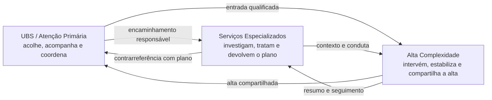

# Tema — Saúde Conectada 2026

> **Fonte:** [`Hackthon 2026.pptx.pdf`](./Hackthon%202026.pptx.pdf) — apresentação oficial do tema (8 slides).
> Este documento é uma **análise interpretativa** do material. Ele não substitui o
> regulamento nem representa requisitos oficiais da organização.

## 1. Identificação

- **Evento:** 10ª Charcode — Hackathon 2026
- **Campus:** Charqueadas — IFSUL
- **Tema:** **Saúde Conectada 2026**
- **Subtítulo:** *Da Atenção Primária à Alta Complexidade*
- **Nicho:** saúde digital, integração da linha de cuidado e interoperabilidade
  entre níveis de atenção do SUS.

### Tese central

O cuidado não se perde por falta de capacidade técnica de cada ponto, mas
**quando a informação para no caminho**. A solução precisa conectar a jornada do
paciente entre Atenção Primária, serviços especializados e alta complexidade,
garantindo que o contexto clínico circule — e **volte para quem coordena o
cuidado**.

> "Cada ponto cuida bem do seu trecho — mas o paciente atravessa todos."
> — Slide 2

## 2. Problema

### O que acontece hoje

O paciente transita entre:

- **UBS / Atenção Primária:** primeiro contato, acompanhamento e coordenação.
- **Serviços especializados:** investigação, diagnóstico, conduta e seguimento.
- **Hospital / Alta Complexidade:** urgência, internação, intervenção e alta.

Cada serviço registra o que precisa para si. Quando o paciente muda de nível,
o contexto clínico não acompanha. Isso gera:

- repetição de exames e relatos;
- atraso na conduta;
- perda de seguimento;
- decisões tomadas com informação incompleta;
- risco na transição, especialmente na alta hospitalar;
- sensação de que o paciente "recomeça do zero" em cada porta.

### Por que isso importa

O problema não é apenas burocrático. A descontinuidade da informação afeta
**segurança clínica, eficiência da rede e experiência da pessoa**. A transição
é justamente o momento em que o cuidado mais precisa de contexto.

## 3. Visão proposta pelo material

> "Um prontuário, três níveis, uma linha de cuidado."
> — Slide 3

A informação deve acompanhar a pessoa e **retornar para quem coordena o
cuidado**. A UBS não é só a porta de entrada: é quem mantém a linha de cuidado
inteira.

A linha de cuidado é um ciclo, não uma sequência de destinos isolados.

## 4. Os três níveis de atenção

### 4.1 Atenção Primária / UBS

**Papel:** acolher, acompanhar e coordenar.

O material destaca três elementos:

- **Território:** reconhecer contexto, riscos e vínculos existentes.
- **Encaminhamento responsável:** pergunta clínica clara, prioridade e retorno
  combinado.
- **Coordenação:** a UBS mantém a visão da linha inteira, mesmo quando o paciente
  está em outro serviço.

**Implicação de produto:** o encaminhamento não pode ser um bilhete solto. Ele
precisa carregar contexto, pergunta clínica, prioridade e expectativa de retorno.

### 4.2 Serviços especializados

**Papel:** investigar, tratar e devolver o plano.

O material organiza a consulta especializada em três partes:

1. **Pergunta:** o que precisa ser investigado ou decidido?
2. **Conduta especializada:** exames, diagnóstico e decisão.
3. **Retorno:** achados, decisão, plano e sinais de alerta.

**Implicação de produto:** a contrarreferência é obrigatória. A especialidade
não é um destino isolado; é uma etapa da linha. Agenda, exames e retorno
precisam conversar com quem acompanha a pessoa.

### 4.3 Alta complexidade / Hospital

O material descreve a internação em três momentos:

| Momento | O que precisa existir |
| --- | --- |
| **Antes** | Contexto clínico completo, indicação, prioridade e exames já realizados |
| **Durante** | Intervenção segura, decisões registradas e equipe integrada |
| **Depois** | Resumo de alta, plano, sinais de alerta e seguimento agendado |

**Entrada qualificada → episódio resolutivo → alta compartilhada.**

> "O hospital cuida do episódio. A rede garante o antes e o depois."

**Implicação de produto:** a alta não encerra o cuidado. O resumo de alta precisa
chegar à UBS e aos serviços que continuarão o acompanhamento, com plano e
sinais de alerta claros.

## 5. Pilares tecnológicos sugeridos

O slide 7 sintetiza o que um sistema precisa entregar:

| Pilar | Significado | Implicação prática |
| --- | --- | --- |
| **Identidade única** | A mesma pessoa reconhecida em toda a rede | Deduplicação e vínculo entre registros |
| **Registro clínico compartilhado** | Problemas, exames, condutas e contexto disponíveis | Linha do tempo longitudinal e acesso por papel |
| **Regulação com retorno** | Encaminhar, priorizar e devolver o plano | Fluxo de referral + contrarreferência |
| **Alertas e continuidade** | Pendências, alta e seguimento chegam a quem precisa agir | Notificações, fila de pendências e prazos |

> "O sistema certo entrega contexto — não apenas dados."

Esse é o critério mais importante para avaliar uma proposta: **dados soltos não
resolvem o problema; contexto acionável resolve.**

## 6. Princípios de produto

1. **Continuidade é o resultado**, não uma tela.
2. **A transição é o produto**: o valor está no handoff, não no cadastro isolado.
3. **A UBS é a coordenadora da linha**; o sistema deve devolver informação a ela.
4. **Todo encaminhamento tem pergunta, prioridade e retorno esperado.**
5. **Toda alta tem resumo, plano, sinais de alerta e seguimento.**
6. **Contexto antes de volume**: mostrar o que muda a decisão, não todos os dados.
7. **Humano no loop**: IA pode resumir e organizar, não decidir clinicamente.
8. **Rastreabilidade**: quem viu, quem alterou, quando e por quê.
9. **Minimização de dados**: coletar e exibir apenas o necessário para o cuidado.
10. **Usabilidade sob pressão**: a equipe precisa entender a tela em segundos.

## 7. Personas e jobs-to-be-done

Personas **derivadas do material**, não fornecidas oficialmente:

| Persona | Contexto | Job to be done |
| --- | --- | --- |
| **Pessoa usuária do SUS** | Atravessa UBS, especialidade e hospital | Não repetir história, entender o próximo passo e não perder seguimento |
| **Profissional da UBS** | Porta de entrada e coordenação | Encaminhar com contexto e receber o plano de volta |
| **Especialista** | Diagnóstico e conduta | Receber uma pergunta clara e devolver um plano completo |
| **Equipe hospitalar** | Urgência, internação e alta | Ter contexto na entrada e garantir continuidade na alta |
| **Regulação / gestão** | Rede e fluxo | Priorizar, acompanhar pendências e enxergar gargalos |

## 8. Oportunidades de solução

### 8.1 Linha do tempo compartilhada

Visão longitudinal do paciente com eventos dos três níveis:

- atendimentos;
- problemas e hipóteses;
- exames e resultados;
- encaminhamentos;
- condutas;
- internações e altas;
- pendências e retornos.

### 8.2 Encaminhamento e contrarreferência estruturados

Fluxo fechado:

1. UBS cria encaminhamento com pergunta clínica, prioridade e contexto.
2. Especialidade registra achados, decisão, plano e sinais de alerta.
3. UBS recebe o retorno e vê o próximo passo.
4. Sistema cobra pendências e prazos.

### 8.3 Alta compartilhada

Pacote de alta com:

- resumo do episódio;
- medicações e plano;
- sinais de alerta;
- follow-up agendado;
- pendências para a UBS;
- confirmação de recebimento pela atenção primária.

### 8.4 Alertas e fila de continuidade

- encaminhamento sem retorno;
- exame pendente;
- alta sem consulta de seguimento;
- paciente com múltiplas transições em pouco tempo;
- risco de perda de acompanhamento.

### 8.5 Painel de gestão da linha

- tempo médio entre encaminhamento e retorno;
- taxa de contrarreferência;
- altas com seguimento agendado;
- gargalos por serviço;
- volume de pendências.

### 8.6 Copiloto de transição com IA

Usos seguros e úteis:

- resumir uma linha do tempo sintética em um rascunho de encaminhamento;
- transformar anotações em um plano de retorno estruturado;
- apontar campos faltantes em um resumo de alta;
- explicar termos para a pessoa usuária, com revisão humana.

**Não usar para:** diagnóstico autônomo, prescrição, triagem clínica sem
validação profissional ou decisão de prioridade sem regra auditável.

## 9. Recorte recomendado para 24h

O material cobre três níveis. Tentar implementar toda a rede em 24h aumenta o
risco de uma demo superficial.

### Recomendação: fechar **um ciclo completo**

**Fluxo UBS → Especialidade → UBS**, porque:

- demonstra o problema central (informação que não volta);
- tem começo, meio e fim em uma demo de 5 minutos;
- exercita identidade, registro compartilhado, encaminhamento e retorno;
- é mais viável do que simular a operação hospitalar inteira;
- pode ser estendido para alta hospitalar se sobrar tempo.

### Roteiro de demo sugerido

1. Profissional da UBS abre o paciente e vê a linha do tempo.
2. Cria um encaminhamento com pergunta clínica, prioridade e contexto.
3. Especialista recebe, registra conduta e devolve plano + sinais de alerta.
4. UBS vê o retorno e o próximo passo.
5. Um alerta mostra uma pendência de seguimento.
6. Se houver IA, o copiloto gera um **rascunho** de resumo, revisado por humano.

### Extensão de alto impacto

**Alta hospitalar → UBS**, com resumo, plano, sinais de alerta e consulta de
seguimento agendada. É o segundo fluxo mais forte do material.

### Fora do recorte inicial

- Integração real com sistemas legados;
- prontuário completo;
- faturamento;
- telemedicina;
- aplicativo do paciente com todas as funções;
- IA clínica autônoma.

## 10. IA, privacidade e LGPD

Saúde envolve **dados pessoais sensíveis**. Qualquer solução precisa tratar isso
desde o design, não como detalhe de pitch.

### Cuidados mínimos

- Usar **dados sintéticos** na demo; nunca dados reais de pacientes.
- Deixar claro no protótipo que os dados são fictícios.
- Definir **papéis e permissões** (UBS, especialista, hospital, gestão).
- Registrar **auditoria** de acesso e alteração.
- Aplicar **minimização**: não enviar histórico inteiro para a IA se um resumo
  basta.
- Não enviar dados identificáveis para LLM externo sem base legal, contrato e
  avaliação de risco.
- Não usar IA para decisão clínica autônoma.
- Prever consentimento/base legal, retenção e descarte.
- Proteger credenciais e não registrar conteúdo clínico em logs.

### Pergunta para a banca

> "Como vocês tratam dados sensíveis e evitam que a IA veja mais do que precisa?"

Uma resposta boa mostra **arquitetura e processo**, não apenas "usamos
criptografia".

## 11. Riscos e perguntas abertas

O material apresenta a visão e o problema, mas **não define**:

- qual transição é a prioridade;
- qual região/população será usada na demo;
- quais sistemas legados precisam ser integrados;
- qual padrão de interoperabilidade é exigido;
- se há dados reais ou sintéticos disponíveis;
- qual modelo de negócio é esperado;
- qual o nível de autonomia permitido para IA;
- como a identidade única será resolvida na prática;
- se há requisito de funcionamento offline.

Perguntas úteis para mentores/jurados:

1. Qual dos três níveis é o maior gargalo hoje na região?
2. O que seria mais valioso: encaminhamento, contrarreferência ou alta?
3. Existe algum sistema que a solução precisaria substituir ou integrar?
4. Qual restrição de LGPD/segurança devemos demonstrar?
5. O que a banca considera uma demo convincente em 5 minutos?

## 12. Como isso conversa com o pitch

| Critério do regulamento | Como o tema ajuda |
| --- | --- |
| **Funcionalidade** | Mostrar um ciclo completo de transição, não só cadastro |
| **Qualidade do código** | Auth, contratos, testes, separação de camadas e IA isolada |
| **Usabilidade** | Linha do tempo clara e handoff em poucos cliques |
| **Inovação** | Contexto acionável + IA de transição com human-in-the-loop |
| **Impacto social** | Redução de repetição, atraso e perda de seguimento no SUS |
| **Modelo de negócios** | SaaS para gestão pública, integração e treinamento |
| **Apresentação** | Narrativa "o cuidado se perde no caminho" + demo de ciclo fechado |

### Narrativa sugerida

1. O problema não é falta de cuidado em cada ponto; é a informação que para no
   caminho.
2. A solução fecha o ciclo entre UBS e especialidade.
3. A demo mostra o encaminhamento, a conduta e o retorno.
4. A IA resume e organiza, mas o profissional decide.
5. O impacto é menos repetição, menos atraso e menos perda de seguimento.

## 13. Glossário

- **APS / Atenção Primária:** primeiro nível de atenção, próxima da comunidade.
- **UBS:** Unidade Básica de Saúde; porta de entrada e coordenação do cuidado.
- **Alta complexidade:** atendimentos de maior densidade tecnológica, como
  internação e urgência.
- **Linha de cuidado:** trajetória organizada da pessoa entre serviços e níveis.
- **Encaminhamento:** envio qualificado para outro serviço.
- **Contrarreferência:** retorno do plano e das informações para quem encaminhou.
- **Regulação:** priorização e organização do acesso aos serviços.
- **Prontuário compartilhado:** registro clínico acessível entre pontos de cuidado.
- **Interoperabilidade:** capacidade de sistemas trocarem informação com sentido.
- **FHIR/HL7:** padrões candidatos para interoperabilidade em saúde.
- **LGPD:** Lei Geral de Proteção de Dados; saúde é dado pessoal sensível.
- **Human-in-the-loop:** decisão final permanece com o profissional.

## 14. Limitações desta análise

- Baseada apenas nos 8 slides do PDF; não há notas do apresentador.
- O slide 8 é de encerramento, sem conteúdo adicional relevante.
- Personas, recortes e fluxos são **interpretações** para orientar o time.
- Nada aqui substitui o regulamento, os critérios da banca ou orientações da
  organização.
